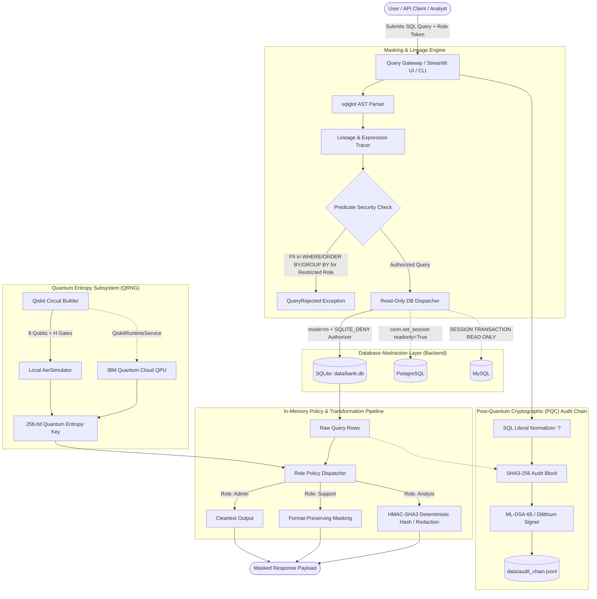

# System Architecture Specification
## Smart Data Masking System for PII & Financial Protection
> **BFSI Problem Statement 1 | TalentAP Mega Hackathon 2026**

---

## 1. Architectural Overview & Design Philosophy

The **Smart Data Masking System** is an enterprise-grade, database-agnostic security middleware engineered for core banking, financial services, and insurance (BFSI) environments. It resolves the fundamental conflict between **data utility** (enabling customer support and analytics) and **regulatory compliance** (GDPR, HIPAA, PCI-DSS, RBI guidelines).

### Core Architectural Guarantees:
1. **Zero-Trust Physical Immutability:** The raw database is strictly opened in read-only mode (`mode=ro`). Physical immutability is proven through deterministic SHA-256 database dump checksums before and after query execution. Masking never alters stored records.
2. **Query-Time In-Memory Transformation:** Transformations occur in volatile RAM during query processing. An identical SQL query yields distinct projections depending on caller credentials.
3. **AST SQL Lineage & Predicate Security:** Using `sqlglot`, the engine parses queries into Abstract Syntax Trees (ASTs), tracking column ancestry across aliases, mathematical operations, and Common Table Expressions (CTEs), while systematically blocking side-channel inference attacks.
4. **Quantum Random Number Generation (QRNG):** True entropy derived from quantum superposition state collapse ($|\psi\rangle = H^{\otimes n}|0\rangle$) seeds deterministic analytical joins, preventing brute-force rainbow table reconstruction.
5. **NIST FIPS 204 Post-Quantum Cryptographic Auditing:** Audit records are sanitized, hashed into an immutable SHA3-256 blockchain, and signed with **ML-DSA-65 (CRYSTALS-Dilithium)** digital signatures.

---

## 2. End-to-End System Architecture



---

## 3. Component Deep Dive

### 3.1 Automated Multi-Heuristic PII Scanner (`masking/scanner.py`)
The scanner performs autonomous schema discovery and content inspection with multi-layer scoring ($0.0 \le \text{confidence} \le 1.0$):

```
Confidence Score = w_name * NameMatch + w_content * FormatMatch + w_algo * AlgorithmicChecksum
```

1. **Tokenization & Linguistic Hints:** Splits snake_case and camelCase identifiers. Strong hints (`ssn`, `iban`, `card_no`, `aadhaar`, `pan`) heavily boost confidence; weak hints (`nm`, `mob`, `bal`) require content confirmation.
2. **Algorithmic Checksum Validators:**
   - **Luhn Algorithm (`luhn_ok`):** Validates credit card primary account numbers (13-19 digits).
   - **ISO 7064 Mod-97 (`iban_mod97_ok`):** Verifies International Bank Account Numbers.
   - **Verhoeff Check (`verhoeff_check`):** Verifies Indian Aadhaar 12-digit identity numbers.
   - **Indian PAN & IFSC Matchers:** Regex checks for `[A-Z]{5}[0-9]{4}[A-Z]` and bank branch routing codes.
3. **Disguised Column Discovery:** If a column name is generic (e.g., `col_7`, `notes`, `contact`) but $>80\%$ of sampled rows match sensitive formats, content evidence overrides naming heuristics.
4. **Decoy Suppression:** Boolean flags and system indicators (`ssn_verified`, `is_active`, `card_ref`, `rrn`) are classified as `NON_SENSITIVE` to eliminate false positives.
5. **Schema Fingerprinting:** Computes a SHA3-256 fingerprint over table/column metadata to cache the catalog (`data/pii_catalog.json`) and invalidate it only when database schemas evolve.

---

### 3.2 Dynamic Masking & Lineage Engine (`masking/engine.py`)
Built on top of `sqlglot`, the engine guarantees robust runtime protection:

1. **AST-Driven Origin Tracing:**
   - Resolves table aliases: `FROM customers c JOIN accounts a ON a.customer_id = c.customer_id`.
   - Traces derived projections: `SELECT c.cust_nm AS client_name, a.curr_bal * 1.1 AS adjusted_balance`.
   - Resolves Common Table Expressions (CTEs):
     ```sql
     WITH client_cte AS (SELECT ssn AS tax_id FROM customers)
     SELECT tax_id FROM client_cte;
     ```
     The engine identifies `tax_id` originates from `customers.ssn` and applies `PII_HIGH` restrictions.
2. **Predicate Side-Channel Defense:**
   In standard systems, a malicious user can deduce sensitive data through boolean filtering:
   ```sql
   SELECT customer_id FROM customers WHERE ssn LIKE '987%'
   ```
   The engine analyzes the AST `Where`, `Order`, `Group`, and `Having` clauses. If a non-admin role references any `PII_HIGH` column in a predicate, the query is rejected immediately with a `QueryRejected` exception.
3. **Free-Text Heuristic Scrubbing (`scrub_text_pii`):**
   Unstructured text columns (e.g., customer support chats, transaction notes) are sanitized in-flight using regex replacers to neutralize leaked emails, phone numbers, and SSNs.

---

### 3.3 Role-Based Access Control Policies (`masking/maskers.py`)

| Data Category | Admin Role | Support Role | Analyst Role | Fail-Closed (Unknown) |
| :--- | :---: | :---: | :---: | :---: |
| **`PII_HIGH`**<br>(SSN, Card No, Aadhaar, PAN) | Cleartext | Partial Mask<br>`4111-XXXX-XXXX-1111`<br>`XXX-XX-6789`<br>`XXXX-XXXX-1234` | HMAC-SHA3-256 Token<br>`h_28acc77d2680...` | `[REDACTED]` |
| **`PII_MEDIUM`**<br>(Names, Emails, Phones, DOB, Address) | Cleartext | Partial Mask<br>`S*** G***`<br>`g***@domain.com`<br>`+XX-XXXXXX1099` | `[REDACTED]` | `[REDACTED]` |
| **`FINANCIAL_CONFIDENTIAL`**<br>(Balances, Credit Limits, Incomes) | Cleartext | Range Bucket<br>`10,000-50,000`<br>`100,000+` | `[REDACTED]` | `[REDACTED]` |
| **`NON_SENSITIVE`**<br>(IDs, Timestamps, Quantities) | Cleartext | Cleartext | Cleartext | `[REDACTED]` |

#### Deterministic Analytical Joins (HMAC-SHA3-256)
Analysts must often correlate records across multiple tables (e.g., join `customers` and `loan_applications` on identity keys) without viewing raw identities. The engine hashes sensitive fields with HMAC-SHA3-256 seeded by quantum entropy:
```
Token = "h_" + HMAC_SHA3_256(QuantumSeed, Normalize(Value))[:16]
```
Identical identity numbers yield identical tokens within an analytical session, preserving joinability while preventing reverse plaintext lookup.

---

### 3.4 Quantum Entropy Generator (`masking/quantum_entropy.py`)
To prevent adversaries from precomputing rainbow tables against analytical hashes, salt generation leverages quantum mechanical superposition:

```
|0⟩ ─── [ H ] ─── [ Measure ] ───> {0, 1} with P = 50%
```

1. **Quantum Circuit Construction:** An 8-qubit register is prepared with Hadamard gates ($H^{\otimes 8}$) applied to the ground state $|00000000\rangle$, creating a maximal superposition state:
   $$|\psi\rangle = \frac{1}{\sqrt{256}} \sum_{x=0}^{255} |x\rangle$$
2. **Measurement & Sampling:** Executed with 32 measurement shots.
3. **Execution Backends:**
   - **Local Mode (Default):** High-performance physical simulation via `qiskit_aer.AerSimulator`.
   - **Cloud Mode (Live QPU):** Direct hardware execution on the **IBM Quantum Platform** (`ibm_kingston`, Heron 156-qubit QPU) via `qiskit-ibm-runtime`.
4. **Digest Derivation:** Extracted bitstrings are mixed with system entropy through SHA3-256 to provide NIST-compliant cryptographic keys.

---

### 3.5 NIST FIPS 204 Post-Quantum Tamper-Evident Audit Chain (`masking/audit.py`, `masking/pqc.py`)

Regulatory frameworks mandate non-repudiation and immutable logging. However, logging raw queries risks leaking the very PII the system is designed to protect.

```
┌────────────────────────────────────────────────────────┐
│                   Audit Block #n                       │
├────────────────────────────────────────────────────────┤
│ Index          : 42                                    │
│ Timestamp      : 2026-10-30T14:35:00.123Z              │
│ Role           : support                               │
│ Sanitized SQL  : SELECT cust_nm, ssn FROM cust WHERE ? │
│ Columns Masked : ["ssn", "cust_nm"]                   │
│ Row Count      : 10                                    │
│ Prev Block Hash: 9e24f8d... (SHA3-256)                 │
├────────────────────────────────────────────────────────┤
│ Block Hash     : a418b7c... (SHA3-256)                 │
│ Signature      : ML-DSA-65 (NIST FIPS 204 / Dilithium) │
└────────────────────────────────────────────────────────┘
```

1. **Parameter Normalization:** Replaces all literal constants (strings, integers, floats) in queries with `?` prior to logging.
2. **Cryptographic Blockchain:** Each entry encapsulates the SHA3-256 hash of the preceding block (`prev_hash`).
3. **Post-Quantum Signatures:** The block hash is signed using **ML-DSA-65 (Dilithium)**. Verifiers can mathematically prove audit logs were not modified or reordered, even against future quantum computing adversaries.

---

### 3.6 Multi-Backend Abstraction Layer (`masking/backends.py`)
The system abstracts physical storage behind a clean 5-method interface:
- `quote(ident: str) -> str`
- `list_tables() -> list[str]`
- `list_columns(table: str) -> list[tuple[str, str]]`
- `execute_readonly(sql: str, params=(), max_rows=1000) -> tuple[list[str], list, bool]`
- `sample(table: str, column: str, n=200) -> list`

#### Implemented Adapters:
1. **SQLite (`SQLiteBackend`):** Opened with URI `file:<path>?mode=ro`. Enforces strict authorizer callbacks (`SQLITE_DENY` on inserts, updates, alters, attaches, and pragmas).
2. **PostgreSQL (`PostgresBackend`):** Enforces driver-level read-only transactions (`conn.set_session(readonly=True)`) and queries `information_schema`.
3. **MySQL (`MySQLBackend`):** Executes queries under `SESSION TRANSACTION READ ONLY`.

---

## 4. Threat Model & Security Mitigations

| Threat Vector | Attack Scenario | Mitigation Strategy |
| :--- | :--- | :--- |
| **Predicate Leakage** | Attacker queries `WHERE ssn LIKE '9%'` to infer values digit-by-digit. | AST Lineage engine rejects any `PII_HIGH` column in `WHERE`, `ORDER BY`, or `GROUP BY` clauses for non-admins. |
| **CTE / Alias Obfuscation** | Attacker masks a column behind an alias `WITH t AS (SELECT ssn AS x FROM c)`. | `sqlglot` lineage traces derived identifiers back to their physical column definitions. |
| **Physical Storage Modification** | Malicious injection or misconfiguration attempting `UPDATE` or `DROP`. | Connections enforced with `mode=ro` and driver authorizer callbacks; underlying SQLite DB dump hash checked. |
| **Rainbow Table Reversal** | Adversary precomputes SHA256 hashes of all valid SSNs or Card numbers. | Analytical tokens are keyed using dynamic 256-bit Quantum Entropy (QRNG), rendering static rainbow tables invalid. |
| **Audit Ledger Tampering** | Rogue DBA alters audit logs to conceal unauthorized data extraction. | Chained SHA3-256 blocks signed with NIST FIPS 204 ML-DSA-65 post-quantum digital signatures. |

---

## 5. Deployment Topology

```
┌────────────────────────────────────────────────────────────┐
│                       Host System                          │
│                                                            │
│   ┌────────────────────────────────────────────────────┐   │
│   │        Streamlit Dashboard (Port 8501)             │   │
│   │   - Interactive Role Switcher                      │   │
│   │   - Side-by-side Role Comparison                   │   │
│   │   - PII Heuristic Catalog Viewer                   │   │
│   │   - Cryptographic Audit Verifier                   │   │
│   └─────────────────────────┬──────────────────────────┘   │
│                             │ In-Memory Query Interception │
│                             ▼                              │
│   ┌────────────────────────────────────────────────────┐   │
│   │       Masking Engine Middleware (Python 3.12+)     │   │
│   │   - sqlglot Lineage Tracer                         │   │
│   │   - Policy Masker & Scrubbers                      │   │
│   │   - Qiskit Aer / IBM Quantum Connector             │   │
│   │   - ML-DSA-65 PQC Signer                           │   │
│   └────────────┬─────────────────────────┬─────────────┘   │
│                │ Read-Only Queries       │ Read Keys       │
│                ▼                         ▼                 │
│   ┌─────────────────────────┐   ┌──────────────────────┐   │
│   │ data/bank.db (Read-Only)│   │ keys/*_pk, *_sk.bin  │   │
│   │ (129,000+ Saffron Rows) │   │ (ML-DSA-65 / Kyber)  │   │
│   └─────────────────────────┘   └──────────────────────┘   │
└────────────────────────────────────────────────────────────┘
```
